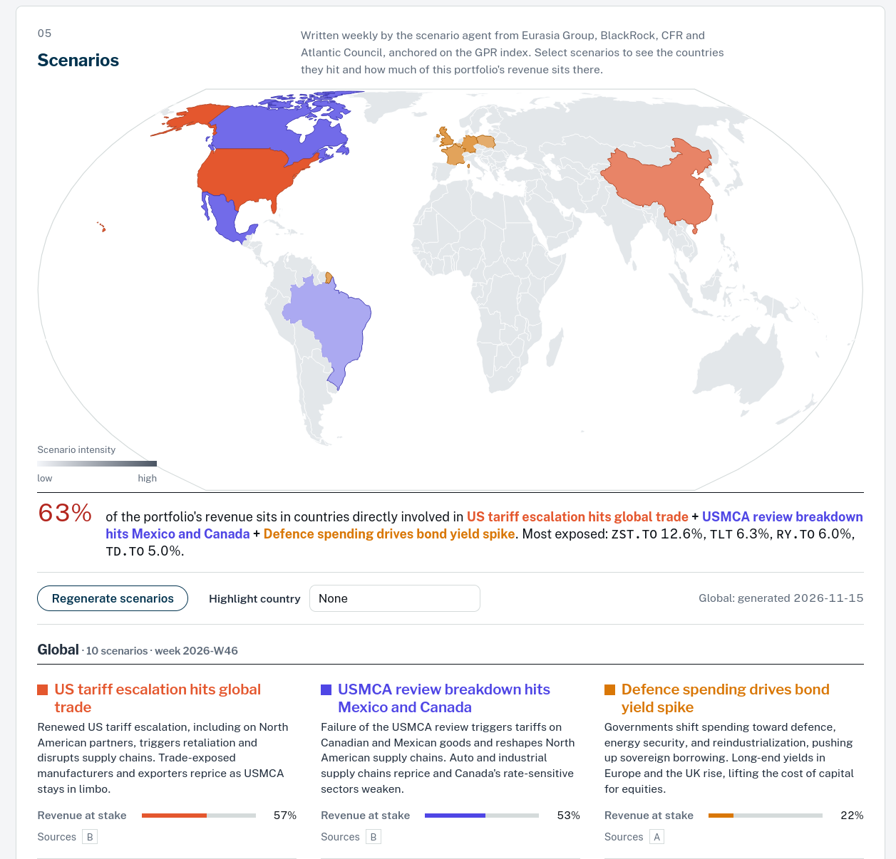

- **Context:** PolyFinances Datathon 2026 (November 2026), team of four, vibe-coded in 36 hours
- **Role:** Team lead and integrator: architecture, LLM layer, web app and pipeline
- **Stack:** Python, AWS Bedrock (Converse API), CloudTrail Lake, S3, FastAPI, htmx, D3, Vercel

AlphaForge reviews the geopolitical risk of an investment portfolio and fits the review to the investor's profile. A web form takes the holdings and a risk profile. Agents gather facts from live sources (SEC filings, Yahoo Finance, the Geopolitical Risk index, the World Bank). Code computes every number. The report explains the score and proposes changes that fit the profile.

<figure style="text-align:center">
  <video src="/assets/video/alphaforge_demo.mp4" poster="/assets/img/projects/alphaforge-run-poster.jpg"
         autoplay muted loop playsinline controls
         style="width:100%; max-width:720px; border-radius:8px; border:1px solid #ddd;"></video>
  <figcaption>A 28-holding portfolio going through the pipeline, from market data and filings to the recommendations.</figcaption>
</figure>

## Design rule: no LLM-written number enters the score

Language models extract facts, such as verbatim quotes or a revenue share stated in a filing, and code verifies them before use. Every number in the score is computed by code. When a model writes numbers in its prose summary, they are checked against the facts it was given. When a source fails, the report says so instead of filling the gap.

## Pipeline

Ten agents, each able to fail on its own without breaking the run. Steps 2 to 4 run in parallel.

1. **Market data and exposure:** prices, and each holding's revenue split by country. The split comes from the best available tier: XBRL tables in the 10-K, then filing text (each share must sit in a quote that states it), then sector peers, a home-bias prior, or a returns-based regression on country ETFs. Each holding is tagged with the tier used.
2. **Company disclosures:** an agent reads filings in a tool loop and flags which of 8 risk channels the company discloses, each backed by a verified quote.
3. **Macro and geopolitical risk:** World Bank indicators for macro fragility, and a country hazard built from political stability and the GPR index.
4. **Scoring:** a two-stage formula combines the three inputs, weighs each by how much of the portfolio it actually covers, and compares the result with the investor's tolerance.
5. **Recommendations:** code proposes swaps; an agent suggests alternatives, which code then sizes and re-scores.

<figure style="text-align:center">
  
  <figcaption>Scenarios written weekly by the scenario agent, with the share of the portfolio's revenue in the countries they hit.</figcaption>
</figure>

## Audit trail

Every LLM call goes through one wrapper on Bedrock Converse. Each call records tokens in and out, input and output, written to a daily log and sent to CloudTrail Lake as a custom event, linked to AWS's own `Converse` event by request ID. Any number in a report can be traced back to the call and source that produced it.

## My part

I set up the project (Bedrock access, data schemas, conventions shared by the agents), built the LLM layer and the web app, wired the agents into the pipeline, and merged the four branches into the final version. I also deployed the demo on Vercel, replaying cached portfolios so it runs within serverless time limits.

Team: Mateo Mangialomini, Cedric Vaval, Luc Moulot, Andy Koutou.

[Code](https://github.com/mateo-496/alphaforge)